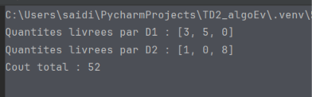

## 🚚 Exercice 2 — Problème de transport

L'objectif est de **minimiser le coût total de transport** des conteneurs entre plusieurs dépôts et magasins tout en respectant les contraintes du problème.

Les contraintes principales sont :

- La **capacité disponible** dans chaque dépôt.
- La **demande** de chaque magasin.
- Les **coûts de transport** entre les dépôts et les magasins.

Pour les données fournies dans le sujet, une solution optimale permet d'obtenir un coût total de transport de :

52 unités de coût




La recherche taboue est utilisée afin d'explorer efficacement les différentes solutions possibles et de rechercher une solution de faible coût.

---

## 🏎️ Exercice 3 — Problème du voyageur de commerce

Le **problème du voyageur de commerce (TSP)** consiste à trouver un circuit de coût minimal permettant de visiter les huit villes une seule fois et de revenir à la ville de départ.

### Solution initiale

La solution initiale imposée est :

```text
1 → 2 → 3 → 4 → 5 → 6 → 7 → 8 → 1
```

Son coût initial est de :

> **103 unités de coût**

Deux métaheuristiques sont appliquées au problème :

- **Recherche taboue**
- **Recuit simulé**

Pour le recuit simulé, le problème est étudié avec **cinq itérations** et une température décroissante.

### Hypothèses

- Les liaisons absentes du tableau des coûts sont considérées comme **interdites**.
- La matrice des coûts est supposée **symétrique**.

ombinatoire**. le coût total de transport en respectant les capacités des dépôts et les demandes des magasins.